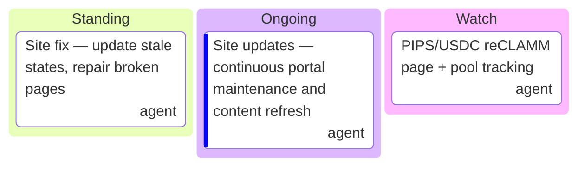

# site/TODO.md — Liquidity Portal

> **READ FIRST:**
> - Project-bounded tasks for site/ (liquidity domain).
> - Covers: Liquidity Portal, reCLAMM, Balancer pNUT Pool, Staking Interface, site pages.
> - When done → archive to `../completed/`. When removed → archive to `../archive/`.

---

## Kanban (at a glance)

---

## Outline (section explainers)

| Section | Explainer |
|---|---|
| **Portal** | Liquidity portal pages — tokens, pools, bonding curves, staking interface. |
| **reCLAMM** | Live PIPS/USDC reCLAMM (0xB19e...Dd44, 1% fee) + NUT/SALT recipe mirror. |
| **Balancer** | pNUT pool + Balancer v3 integration pages. |
| **Staking** | Staking interface + reward display. |

---

## Indexed Items

1. **S-1 — Stale-state repairs** · Medium · agent
   Update stale states on portal pages; repair broken pages when encountered. Ongoing when possible.
2. **S-2 — reCLAMM tracking** · Medium · agent
   Keep PIPS/USDC reCLAMM pool data current on the portal; reflect the blocked 7.75M PIPS LP need (~$120 USDC).
3. **S-3 — Continuous maintenance** · Low · agent
   Portal content refresh and upkeep.
